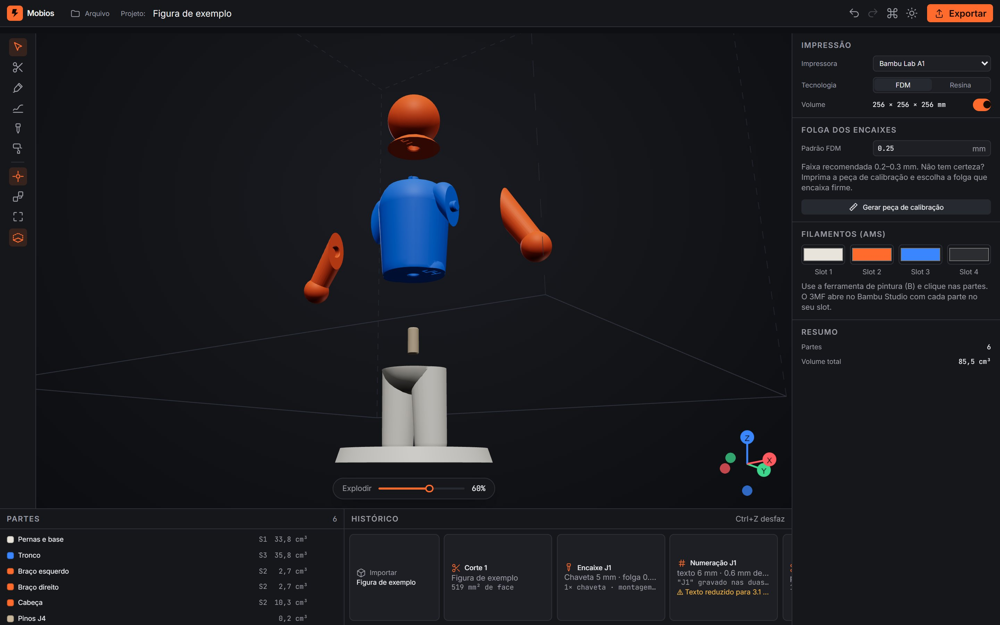
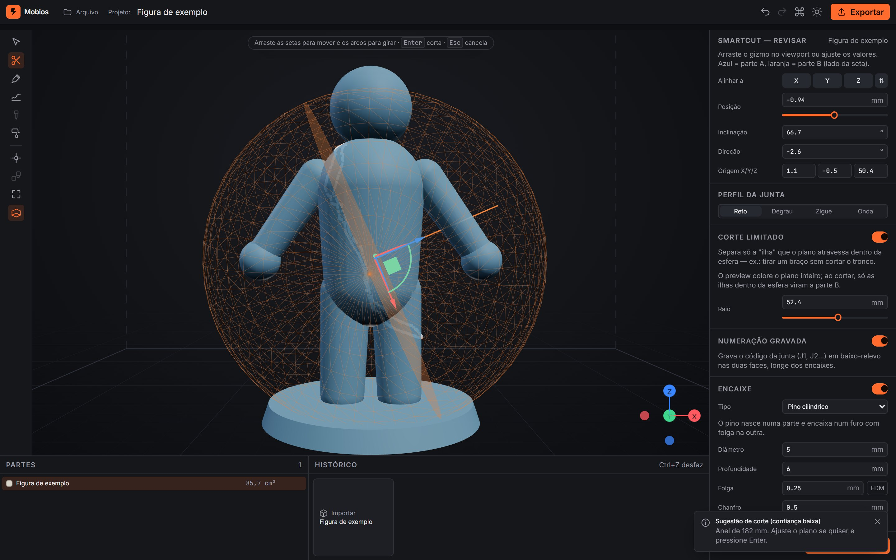
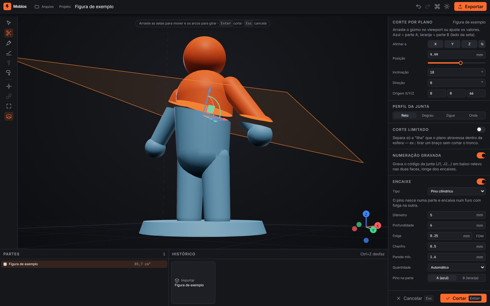
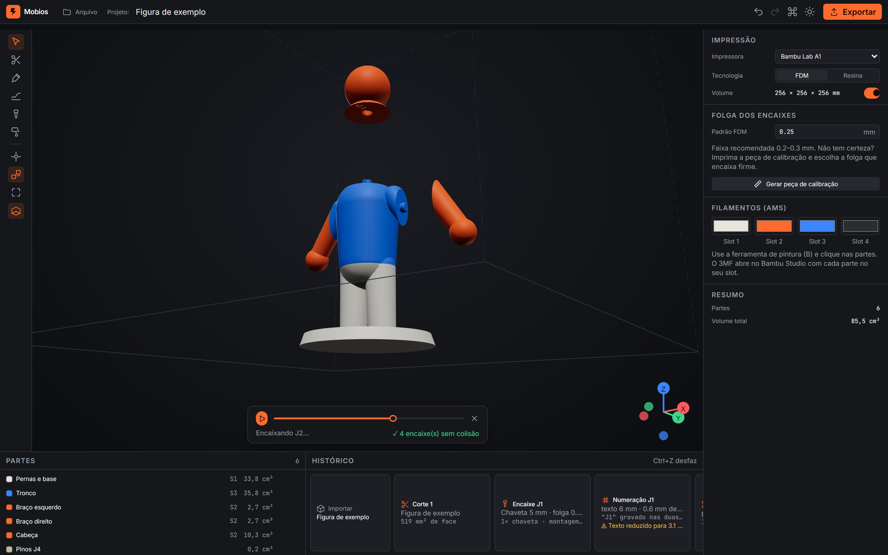
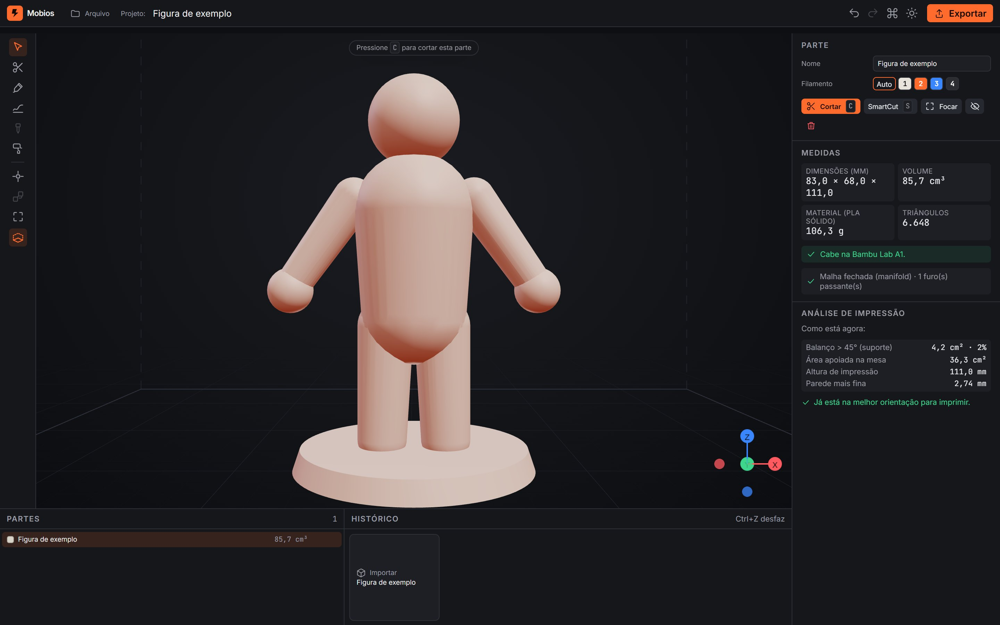
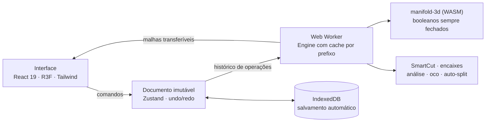

<div align="center">


# Mobios

**Corte qualquer modelo 3D em partes imprimíveis — com encaixes que encaixam de primeira.**

Cortes que seguem a anatomia da peça, pinos e trilhos com a folga certa para a sua impressora,
montagem simulada sem colisão e exportação pronta para o Bambu Studio. Tudo no navegador, também offline.

[](https://muzashii.github.io/mobios/)

[](https://github.com/Muzashii/mobios/actions/workflows/ci.yml)
[](https://github.com/Muzashii/mobios/actions/workflows/pages.yml)


</div>

<br />

<p align="center">
  
</p>
<p align="center"><sub>Uma figura dividida em 5 partes: cabeça com chaveta, braços separados no ombro sem cortar o tronco, pernas com pino solto — cada parte no seu slot de filamento.</sub></p>

---

## Por que o Mobios

Imprimir uma peça grande em partes costuma terminar em três frustrações: **o corte passa onde não devia** (um plano reto que atravessa o boneco inteiro), **o encaixe não encaixa** (folga errada para a sua impressora) e **a montagem vira quebra-cabeça** (qual peça vai onde?).

O Mobios resolve as três:

- **Corta onde faz sentido** — o SmartCut acha a articulação (ombro, pescoço, cintura) a partir de uma pincelada; o corte limitado separa um braço sem tocar no tronco.
- **Encaixa de primeira** — sete tipos de encaixe com folga calibrada por tecnologia (FDM ou resina), posicionados automaticamente e **verificados contra colisão** antes de você imprimir.
- **Monta sem dúvida** — cada junta recebe um código gravado nas duas faces (J1 ↔ J1), e o app gera um guia de montagem ilustrado, passo a passo.

E nada é destrutivo: todo corte fica num histórico editável. Mudou de ideia sobre a altura do primeiro corte? Edite — tudo o que veio depois é recalculado.

## Destaques

<table>
  <tr>
    <td width="50%" valign="top">
      
      <h3>🧠 SmartCut</h3>
      Pincele o braço (ou só clique na ponta) e o Mobios encontra o anel mais estreito e côncavo — a articulação — e propõe um corte limitado que você ainda pode ajustar.
    </td>
    <td width="50%" valign="top">
      
      <h3>✂️ Corte com preview ao vivo</h3>
      Arraste o gizmo e veja as duas metades na hora, em 60 fps. Plano, corte limitado, curva desenhada à mão ou junta em degrau, zigue-zague e onda.
    </td>
  </tr>
  <tr>
    <td width="50%" valign="top">
      
      <h3>🧩 Montagem simulada</h3>
      Assista às peças se encaixando uma a uma. Cada encaixe é varrido ao longo da direção de montagem — se algo colide, você descobre aqui, não depois de 9 horas de impressão.
    </td>
    <td width="50%" valign="top">
      
      <h3>🖨️ Pronto para imprimir</h3>
      Balanços, área de apoio, paredes finas, se cabe na sua impressora e a melhor orientação. Peça grande demais? Um clique divide com o menor número de cortes.
    </td>
  </tr>
</table>

## Tudo o que ele faz

| | |
|---|---|
| **Importar** | STL (binário e ASCII), OBJ e 3MF multi-objeto, arrastando o arquivo. **Reparo automático** de malhas quebradas — vértices soltos, faces duplicadas, normais invertidas, buracos, cascas sobrepostas — com relatório do que foi corrigido. Aviso de escala suspeita (polegadas/metros). |
| **Cortar** | Plano com gizmo e valores numéricos · **corte limitado** a uma esfera · **SmartCut** por pincel · **curva livre** desenhada na tela · perfis de junta **degrau, zigue-zague e onda**. |
| **Encaixar** | Pino cilíndrico, **quadrado** e **hexagonal** (não giram), **chaveta** (orientação única), **pino solto** (impresso à parte), **ímã** e **rabo-de-andorinha** deslizante. Posição automática no ponto mais "fundo" da face, vários pinos em faces alongadas, e **nunca fura a parede** — encurta ou descarta com aviso. |
| **Folgas** | Presets para FDM (0,2–0,3 mm) e resina (0,1–0,15 mm), editáveis, e uma **peça de calibração** com 5 folgas para você imprimir e escolher a sua. |
| **Montar** | **Verificação de colisão** por encaixe, **animação de montagem**, vista explodida e **numeração gravada** em baixo-relevo nas duas faces de cada junta. |
| **Preparar** | Análise de balanços e paredes, **orientação sugerida** aplicada na exportação, **auto-split** para caber na mesa (Bambu A1, A1 mini, X1/P1, ELEGOO Mars 5 Ultra) e **oco para resina** com furos de drenagem e aviso de efeito ventosa. |
| **Multicolor** | 4 slots de filamento (AMS, AMS lite, BMCU) e pintura por parte. |
| **Exportar** | **3MF com um objeto por parte, cada um no seu slot** — abre colorido no Bambu Studio · STL e OBJ em ZIP · projeto editável `.mobios` · **guia de montagem** em HTML com imagens de cada passo. |
| **Projeto** | Undo/redo ilimitado, histórico editável, salvamento automático no navegador, paleta de comandos (`Ctrl+K`), tema claro e escuro, tour de primeiros passos. |

## Comece em 1 minuto

1. **Abra** [muzashii.github.io/mobios](https://muzashii.github.io/mobios/) e clique em **Abrir exemplo** (ou arraste o seu STL).
2. **Corte** — selecione a peça e pressione <kbd>C</kbd> para um plano, ou <kbd>S</kbd> para o SmartCut. Confirme com <kbd>Enter</kbd>.
3. **Encaixe** — o corte já vem com pino e numeração. Troque o tipo e a folga no histórico.
4. **Exporte** — <kbd>Ctrl</kbd>+<kbd>E</kbd> gera o 3MF para o Bambu Studio.

> **Instale como aplicativo:** no Chrome ou no Edge, clique em **Instalar** na barra de endereço. O Mobios ganha atalho no menu Iniciar, abre em janela própria, funciona **offline**, abre `.stl`/`.3mf`/`.mobios` direto do Explorador e se atualiza sozinho.

<details>
<summary><b>Atalhos de teclado</b></summary>

| Tecla | Ação | Tecla | Ação |
|---|---|---|---|
| <kbd>C</kbd> | Corte por plano | <kbd>E</kbd> | Vista explodida |
| <kbd>S</kbd> / <kbd>B</kbd> | SmartCut / pincel | <kbd>M</kbd> | Simular montagem |
| <kbd>L</kbd> | Corte por curva livre | <kbd>F</kbd> | Focar seleção |
| <kbd>P</kbd> | Editar encaixe | <kbd>H</kbd> | Ocultar parte |
| <kbd>T</kbd> | Pintar filamento | <kbd>[</kbd> <kbd>]</kbd> | Raio do pincel |
| <kbd>Enter</kbd> / <kbd>Esc</kbd> | Confirmar / cancelar | <kbd>Ctrl</kbd>+<kbd>Z</kbd> / <kbd>Y</kbd> | Desfazer / refazer |
| <kbd>Ctrl</kbd>+<kbd>S</kbd> | Salvar projeto | <kbd>Ctrl</kbd>+<kbd>K</kbd> | Paleta de comandos |

</details>

## Como funciona



- **Geometria fora da tela** — todo corte, encaixe e reparo roda num Web Worker com o [manifold-3d](https://github.com/elalish/manifold), que garante malhas sempre fechadas (manifold). A interface nunca trava.
- **Histórico reexecutável** — o projeto é uma lista de operações com IDs determinísticos. Editar o corte nº 1 recalcula só dali em diante, reaproveitando o resto.
- **SmartCut** — distância geodésica a partir da região pincelada, anéis pontuados por perímetro e concavidade, e a *Shape Diameter Function* para entender a espessura do membro sob o pincel. Detalhes no [ADR 0004](docs/ADR/0004-smartcut-e-cortes-livres.md).
- **Leve para abrir** — o motor 3D e o WASM só carregam quando há um modelo. A primeira tela carrega 180 KB de JavaScript (gzip).

Todas as decisões de arquitetura estão registradas em [`docs/ADR`](docs/ADR), e a especificação completa em [`docs/SPEC.md`](docs/SPEC.md).

## Qualidade em números

| | |
|---|---|
| **Lighthouse** | Desktop **100 · 100 · 100 · 100** — celular **93 · 100 · 100 · 100** (desempenho, acessibilidade, boas práticas, SEO) |
| **Testes** | 66 testes automatizados, incluindo testes de propriedade (120 cortes aleatórios por execução conservam volume e geram malhas fechadas) |
| **SmartCut** | Acerta a articulação nas 5 figuras de referência (ombro, pescoço, barra de haltere, caule, junção em T) |
| **Garantias verificadas** | Toda parte é uma malha fechada · nenhum encaixe fura a parede · encaixes montam sem colisão |
| **Acessibilidade** | Navegável por teclado, contraste AA nos dois temas, respeita "reduzir movimento" |
| **Desempenho** | Corte de 500 mil triângulos em ~0,85 s (meta: 0,5 s — ver [ADR 0003](docs/ADR/0003-orcamento-de-desempenho.md)) |

## Desenvolvimento

Requer [Node.js](https://nodejs.org) 20 ou mais novo.

```bash
git clone https://github.com/Muzashii/mobios.git
cd mobios
npm install
npm run dev
```

| Comando | O que faz |
|---|---|
| `npm run dev` | Servidor de desenvolvimento em `localhost:5173` |
| `npm run test` | Testes unitários e de propriedade (Vitest + fast-check) |
| `npm run bench` | Orçamento de desempenho com malha de 500 mil triângulos |
| `npm run build` | Typecheck + build de produção com service worker |
| `npm run lighthouse` | Auditoria Lighthouse desktop e celular (com `npx vite preview --port 4173` rodando) |
| `npm run e2e` | Testes de ponta a ponta (Playwright) |
| `node scripts/screenshots.mjs` | Regera as imagens deste README |

Cada push na `master` roda o CI e publica o site automaticamente no GitHub Pages.

<details>
<summary><b>Estrutura do projeto</b></summary>

```
src/
├─ geometry/     motor (roda no worker): corte, SmartCut, encaixes, numeração,
│                análise, oco, auto-split, reparo — funções puras e testadas
├─ io/           STL, OBJ, 3MF (com slots do Bambu Studio), ZIP e .mobios
├─ store/        documento do projeto, comandos (undo/redo), sincronização, IndexedDB
├─ features/     viewport 3D, corte, SmartCut, encaixes, montagem, análise, exportação
├─ app/          shell, barra de ferramentas, inspector, histórico, tour, atalhos
└─ ui/           design system: tokens, componentes, ícones
tests/           unidade, propriedade, benchmark e E2E
docs/            SPEC, ADRs e roteiro de teste de usabilidade
```

</details>

## Próximos passos

- [ ] Teste de usabilidade com 3 makers ([roteiro](docs/usability-test.md))
- [ ] Encaixes snap-fit, rosca e perfil "quebra-cabeça" na própria face
- [ ] Exportação STEP para peças simples
- [ ] Sugestão de cortes por IA a partir de uma imagem do modelo
- [ ] Versão desktop nativa (Tauri)

**Limitações conhecidas:** o SmartCut depende de onde você pincela (perto demais do tronco a sugestão perde confiança — o app avisa); o auto-split só faz cortes alinhados aos eixos; o corte por curva livre assume vista sem perspectiva nas bordas.

## Créditos

Construído sobre projetos open source excelentes: [manifold-3d](https://github.com/elalish/manifold) · [three.js](https://threejs.org) · [React Three Fiber](https://github.com/pmndrs/react-three-fiber) e [drei](https://github.com/pmndrs/drei) · [three-mesh-bvh](https://github.com/gkjohnson/three-mesh-bvh) · [Zustand](https://github.com/pmndrs/zustand) · [Radix UI](https://www.radix-ui.com) · [Tailwind CSS](https://tailwindcss.com) · [Comlink](https://github.com/GoogleChromeLabs/comlink) · [fflate](https://github.com/101arrowz/fflate) · [Vite](https://vite.dev) e [vite-plugin-pwa](https://vite-pwa-org.netlify.app).

<div align="center">
<br />
<sub>Feito para quem imprime em partes. <a href="https://muzashii.github.io/mobios/">Experimente agora →</a></sub>
</div>
